# Incident discovery, summary review and immediate publication

Date: 2026-10-30. Status: approved by the user in this conversation on 2026-10-30. Parent milestones: B (collection), D (editorial assistance), E (review), G (publication). Design approval does not approve an individual article for publication.

## Confirmed user decisions

1. Monitor well-known sources for incidents worth publishing in The Security Diff.
2. Scheduled monitoring finds leads; Codex reads the evidence and drafts summary PRs on demand. Do not add an AI provider or API key to GitHub Actions for the first version.
3. An Approve review by Pankaj Mouriya should automatically merge and deploy the summary once validation passes. No separate merge click is intended.

The [source catalogue](../../editorial/incident-sources.md) contains verified feeds, additional research channels and four initial leads. Include software supply-chain compromises, dependency/runtime vulnerabilities and certificate-trust incidents with truthful classifications. A CVE is not required.

## Options and recommendation

| Approach | Benefit | Cost or limitation |
| --- | --- | --- |
| Scheduled discovery plus on-demand Codex drafts; approval triggers publication | Matches the selected workflow, uses current tools, keeps editorial review | Requires a lead queue, a candidate preview and trusted approval/merge/deploy orchestration |
| CI also generates prose using a model API | Fully scheduled drafts | New provider, secret, cost controls and additional editorial validation; excluded from this first version |
| Manual drafting and manual merges only | Smallest setup | Does not deliver the selected monitoring and approval-to-publication behavior |

Recommend the first approach. Implement it as three verifiable parts: discovery, drafting/review, then publication. Keep the existing Vulnerability Watch independent.

## Proposed reader and archival behavior

Approved incidents appear on the homepage and at `/article/[slug]` as soon as the approved deployment succeeds, without waiting for the next daily edition. Use the existing newspaper lead/grid, responsive article presentation, source notes and themes. No separate dashboard or superficial security decorations are needed.

Add a canonical published-story store and a separate latest-news composition. Daily edition routes continue to read immutable historical snapshots. This lets a second article publish on the same date without silently changing the first archived edition. A story has one canonical identity; editions can retain a particular version of that story. Existing edition files need not be rewritten to migrate their reader behavior.

This is the principal proposed contract change. The current loader discovers stories only inside dated editions and rejects duplicate story IDs across editions. Implementation must separate canonical-story identity from edition snapshot identity, preserve existing URLs and archive rendering, and test mixed legacy/new content. Corrections create an explicit new revision and correction note; rebuilds never refetch or rewrite historical facts. The chosen homepage composition must be previewed with multiple same-day incidents and alongside an older daily edition.

## 1. Discovery

Proposed initial schedule: hourly, with manual dispatch for a fresh scan. GitHub schedules can be delayed; an interval is not a guaranteed delivery time. Start with verified feeds and a bounded set of research indexes/structured datasets from the catalogue.

Persist raw retrieval metadata, normalized leads, source checkpoints and the run manifest. Each lead retains canonical URL, source identity, author when available, source publication/update dates, retrieval time, content fingerprint, ecosystem and identifiers. Distinguish a newly discovered older incident from a newly occurring one.

Group related reports using several evidence-backed signals, such as advisory IDs, affected artifact identity, report links and incident dates. A shared package, CVE, campaign name or brand is insufficient on its own: March and October LiteLLM incidents remain distinct. Track updates and source corrections. Preserve withdrawals from structured malicious-package datasets.

Produce a bounded triage queue in GitHub, preferably one rolling issue with stable incident IDs and links to source evidence. Avoid one issue per raw malicious-package record and avoid re-notifying on unchanged inputs. Use deterministic relevance rules; do not manufacture popularity or severity scores. A source failure records reduced coverage and preserves previous leads and checkpoints.

Structured advisory and malicious-package repository commits are change signals, even when their messages say `Publish Advisories` or `Ingest OSV - GHSA Malware`. Keep them in the discovery checkpoint but summarize each stream separately in the issue; do not spend the report-lead slots on raw commit messages. Inspect individual records and their original references to identify a distinct incident or significant vulnerability. Bound retained commit signals independently so a high-volume stream cannot displace all report leads.

## 2. On-demand drafting and candidate review

The editor can ask Codex to draft an identified lead or supply allowlisted source URLs. Codex reads original reports, maintains an attributed evidence packet, and writes only constrained prose/metadata. Use Markdown rather than MDX or generated HTML. Existing authoritative facts and source identity cannot be overwritten by agent output.

Each content PR contains one incident or one explicit correction, compact evidence/provenance, and any proposed homepage placement. Keep pipeline internals, prompt/model identifiers and operational diagnostics outside reader content. The full article checklist is in the source catalogue.

Candidate storage is separate from published storage. Validation rejects fixture content, missing evidence, unsafe links, inconsistent identifiers, unsupported affected/fixed-version claims and attempts by a drafter to set reviewer identity or publication status. Automated shape checks cannot establish factual truth: Codex must reconcile material claims against cited evidence, and the editor reviews the rendered copy and evidence before approving.

The PR preview must render the actual incident candidate using production-compatible content validation in an isolated preview build. Today's general PR preview builds fixtures, so it is insufficient for this purpose. The preview remains clearly marked and `noindex`, while the production corpus stays unchanged until authorized promotion. Preview every content revision and bind the preview/check results to its exact head SHA.

## 3. Approval, merge and deployment

The intended flow is:

```mermaid
flowchart LR
  Sources[Monitored sources] --> Leads[Deduplicated lead queue]
  Leads --> Codex[On-demand evidence and draft]
  Codex --> PR[Bot-authored content PR and real preview]
  PR --> Review[Pankaj approves exact revision]
  Review --> Gate[Required checks and trusted publication gate]
  Gate --> Merge[Merge reviewed revision]
  Merge --> Deploy[Build and deploy approved content]
  Deploy --> Verify[Check article and homepage]
```

Use a bot-authored PR so Pankaj can submit a GitHub Approve review; a PR authored with Pankaj's own CLI identity cannot provide that review path. An on-demand trusted workflow can open the PR against a validated content branch prepared by Codex. Restrict eligible PRs to this repository, a known incident branch pattern, and allowed content paths. A code/workflow/dependency change is never eligible for automatic incident publication.

Treat the review's commit ID as the authorization boundary. Before merging, fetch the latest PR state, confirm the authorized approving identity, verify that approval applies to the current head, require successful candidate/evidence/preview checks for that head, and reject active blocking reviews. New content invalidates the previous approval. If checks finish after approval, completion should re-evaluate the same recorded authorization without requiring another approval click.

Execute the publisher from trusted default-branch code. Candidate Markdown, metadata, source text and PR bodies are untrusted data and must not become shell code, executable imports or workflow instructions. Record the real review event, actor, timestamp and approved content hash in a publisher-owned provenance record. Do not append an unreviewed change to the article after approval. Serialize promotion and merge, use expected-head checks, and make duplicate/replayed events idempotent.

GitHub's native auto-merge was disabled when inspected; classic branch protection for `main` was absent. The incident publisher must enforce its eligibility/review/check requirements itself and respect any repository rules that are subsequently configured. Do not broadly enable auto-merge for unrelated PRs or silently change repository protection settings.

Do not rely on `GITHUB_TOKEN` merges to trigger a `push` deployment. [GitHub documents event suppression and explicit dispatch exceptions](https://docs.github.com/en/actions/how-tos/write-workflows/choose-when-workflows-run/trigger-a-workflow). The first-version design uses explicit trusted workflow dispatch/reusable validation and deployment orchestration rather than adding an external model service or assuming a new GitHub App credential exists. Ensure bot-created PR validation also starts without a separate manual workflow-approval click. A successful merge explicitly queues deployment of the resulting approved merge revision; never dispatch an unchecked arbitrary ref.

Reuse the existing production build, deployment serialization, Cloudflare upload and smoke checks. Verify the new article URL, homepage presence and exact deployed revision, and report success/failure on the PR. Approval queues publication immediately after checks; build and deployment time remain visible and are not a claim of zero-second publication. Failure preserves the last good deployment and supports retry without duplicate publication.

Website approval does not grant newsletter approval. Do not populate newsletter approval fields or widen the existing email-send gates.

## Existing state inspected on 2026-10-30

- Python collectors cover CISA KEV, FIRST EPSS and NVD; incident/news collectors and a general source registry are absent.
- `src/lib/content.ts` loads dated edition JSON and derives all editorial story routes from those records.
- The current incident story type, category taxonomy and rich Markdown article presentation can be reused.
- `.github/workflows/validate.yml` has a fixture PR preview and a main-push production deployment. Manual dispatch currently performs Cloudflare setup, so approval-driven dispatch needs an explicit, distinct entry point.
- Repository production and preview variables are enabled. The production environment returned no protection rules. These observations do not prove deployment health or full repository policy coverage.
- The repository secret listing showed only the Cloudflare API token; no external editorial-provider or GitHub App secret was observed.

No repository setting, secret, workflow or production content was modified during research.

## Acceptance criteria

- Recorded source responses produce stable leads and updates, retain provenance and withdrawals, avoid duplicates, and preserve previous state under source failure or empty/unusable input.
- Replaying source text containing instructions cannot modify allowed destinations, execute code or alter facts/review status.
- The four initial leads can become independent candidate PRs with primary references and honest classifications; they are not published merely by being on the initial list.
- Candidate previews show the real proposed article/homepage at 320, 390, 768, 1024 and 1440 px in both themes, with keyboard checks, unknown values and no unintended overflow.
- A non-approving event, wrong reviewer, stale approval, changed head, blocking review, changed code path or failing check cannot merge or publish. Approval before checks finish eventually publishes only when that same revision passes.
- A bot-authored PR can complete validation, accept the editor's Approve review, merge, dispatch deployment and verify its article without a second manual publishing action. Exercise this in hosted GitHub before claiming acceptance.
- Multiple same-day incidents appear without rewriting historical editions; canonical article URLs, feeds and existing fixture/production isolation continue to work.
- A failed deployment, retry or concurrent approval preserves the last good publication and cannot duplicate the incident or send an unapproved newsletter.

## Decisions for design review

The user approved this design, including canonical story/latest-news separation. No paid provider, database, CMS, reader account or browser-side intelligence fetch is proposed.

## Implementation decisions

The implementation uses structured Markdown headings and plain paragraphs rendered as escaped Astro text. Source facts are short verbatim excerpts checked against captured source text; editorial copy is a separate strict input. Independent CI captures recheck excerpts before a head/hash-bound success check. These checks support review but cannot establish the semantic truth of prose.

The publisher merges the exact approved candidate head first, then writes a separate deterministic publication/provenance commit on `main`. That record embeds the unchanged approved candidate and actual GitHub review event; a non-force single-parent ref update protects concurrent work. Deployment is explicitly dispatched rather than relying on token-generated push events. A failed post-upload verification attempts an ownership-checked rollback to the previously successful Pages deployment.

Recovery refinement, 2026-10-30: PR #23 was merged directly by Pankaj after its candidate validation passed, without an Approve review. The original publisher correctly left the candidate dormant because it only accepted a review event. To honor this actual editor action, a direct merge by the configured editor is an alternate authorization after the same scope, content-hash and check gates. Its publication record stores `approval_kind: merge`, GitHub's actual merge timestamp and commit SHA; it contains no review ID or review timestamp. Other actors' merges and active blocking reviews remain ineligible. A trusted closed-PR event starts publication for future direct merges; older merges can be recovered through a manual dispatch. The reader labels this event as an editorial merge. The primary Approve-review path remains unchanged. The candidate check now links to Wrangler's actual immutable preview URL rather than constructing a branch alias that Cloudflare truncated.

Homepage composition is bounded to twenty latest incident identities plus the latest editorial edition. Existing dated edition files remain unchanged. Native auto-merge/protection settings are not modified. Hosted activation remains gated pending the acceptance exercise documented in the operator runbook.
